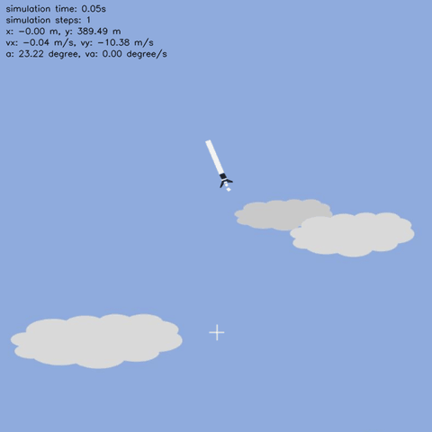
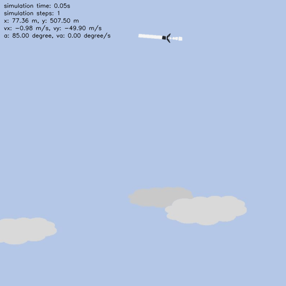
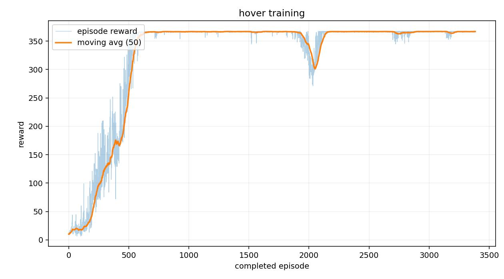
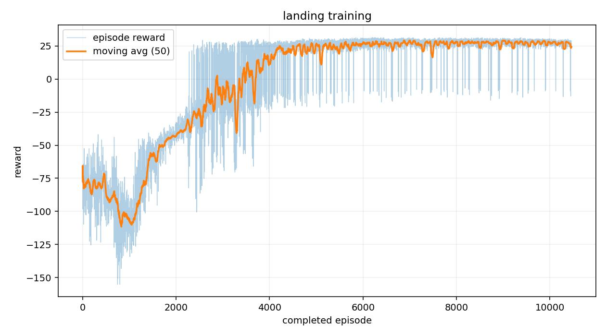
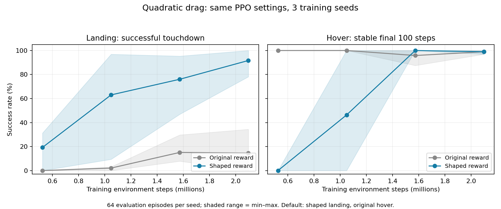
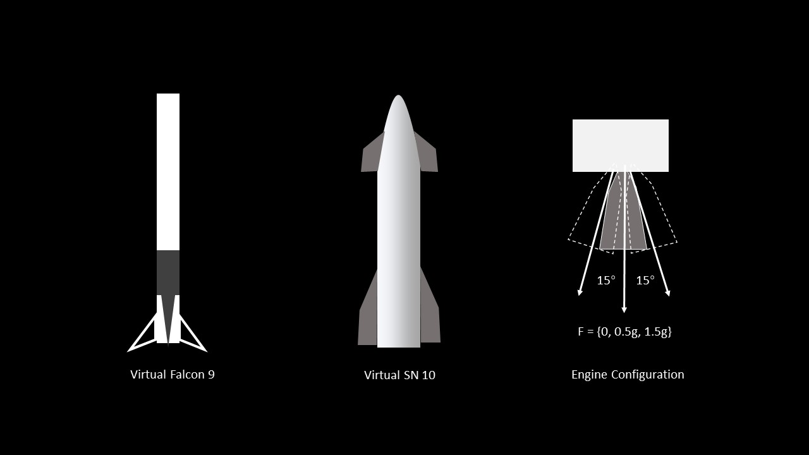
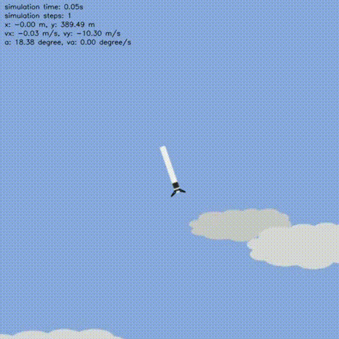
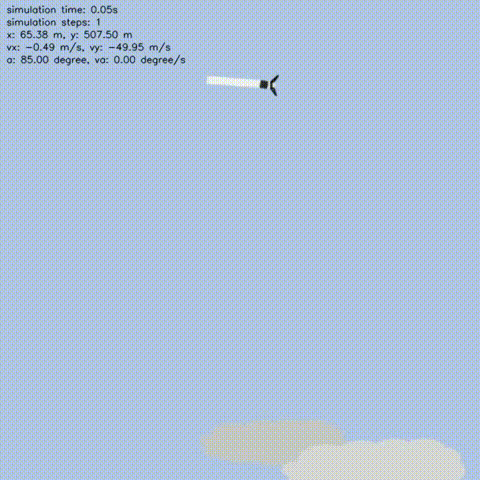
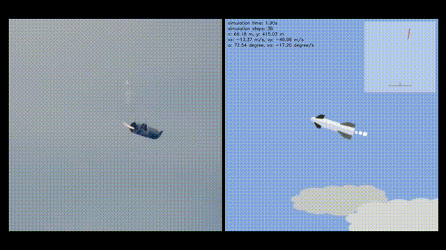

# Rocket-recycling with Reinforcement Learning

Developed by [Zhengxia Zou, Ph.D.](https://zhengxiazou.github.io/).

A lightweight 2D rocket simulator with reinforcement-learning agents for **hovering** and **landing**, inspired by SpaceX rocket recovery. The current implementation uses PPO and runs locally with live training curves and periodic simulation previews.

## September 2026 update

- **PPO-Clip + GAE:** normalized advantages, entropy regularization, gradient clipping and KL-based early stopping. Each rollout is reused for up to four optimization epochs.
- **Batched training:** 32 independent environments collect 128 steps each, producing 4,096 transitions per rollout. Environment steps run sequentially in one process; neural-network inference and learning are batched. This does not launch 32 worker processes.
- **Physical state encoding:** scaled position/velocity inputs and sine/cosine orientation features replace the original high-frequency positional mapping.
- **Quadratic aerodynamic drag:** acceleration is `a_drag = -k * |v| * v`, with `k = 0.004 m^-1`. Drag opposes motion and scales with speed squared. The coefficient preserves the original simulator's approximately 49.5 m/s terminal descent speed; it is a simulation calibration, not a measured rocket aerodynamic model.
- **Landing reward redesign:** altitude-dependent descent-speed guidance, lateral alignment, attitude/rate feedback, progress rewards, and explicit failure/timeout penalties. Crashes no longer receive large positive rewards amplified by remaining episode time.
- **Live visualization and resume:** reward curves, moving averages, recent success rates, periodic rocket previews, and checkpoints that store the environment configuration.

The original hovering reward remains the default because it acquired stable hovering faster in the quadratic-drag comparison. A more precise hovering reward is available as `hover_reward = "shaped_v1"`; it improves final positioning at the cost of slower initial learning.

## Latest results

The following animations and curves were exported from local PPO checkpoints on September 6, 2026. They use quadratic drag: the original hovering reward and the redesigned landing reward.

| Hovering | Landing |
| :---: | :---: |
|  |  |
|  |  |

Checkpoint snapshots: hovering at **3,384 completed episodes / 2,596,864 environment steps**; landing at **10,462 episodes / 3,190,784 steps**. Blue lines show episode reward; orange lines show a 50-episode moving average. Each animation is one sampled rollout (seed 0), not a success-rate estimate. The landing rollout meets the simulator's touchdown criteria; hovering runs for the full 800-step episode. The GIFs play at approximately simulated real time.

### Controlled reward comparison



All curves above use the same quadratic dynamics and PPO settings. Each reward configuration was trained from scratch with seeds 0, 1 and 2, then evaluated on 64 sampled-policy episodes per seed at each checkpoint. Shading shows the minimum–maximum range across training seeds. These controlled runs are separate from the latest checkpoint snapshots above.

| Task and training budget | Original reward | Redesigned reward |
| :--- | ---: | ---: |
| Landing, 1,048,576 environment steps | 2.1% success | **63.0% success** |
| Landing, 2,097,152 environment steps | 14.6% success | **91.7% success** |
| Hovering, 524,288 environment steps | **100% stable hovering** | 0.0% stable hovering |
| Hovering, 2,097,152 environment steps | 99.0% stable hovering | 99.0% stable hovering |

At 2,097,152 steps, the optional hovering reward reduced mean final-window position error from about 18.1 m to 1.5 m. The default prioritizes faster initial acquisition.

A separate evaluation seed, unused during tuning, gave **89.6% landing success** and **97.4% stable hovering** for the selected defaults at the final checkpoint (192 episodes per task). Landing uses the original touchdown conditions: speed <15 m/s, horizontal error <50 m, tilt <10°, and angular speed <10°/s. Stable hovering requires an 800-step episode with at least 80 of the final 100 steps within 50 m of the target, below 5 m/s, and within 10° of upright.

These are finite-sample results, not guarantees for every run. Reward magnitudes are not comparable across different reward definitions. Training curves may still fluctuate. Batching improves computational throughput; PPO and reward design affect how much experience is needed to learn.

## Installation

Tested with Python 3.9, PyTorch 2.8, NumPy 1.26.4, Matplotlib 3.9 and OpenCV 4.11.

```sh
python3 -m venv .venv
source .venv/bin/activate
python -m pip install -r Requirements.txt
```

On Windows, activate the environment with `.venv\Scripts\activate`. For PyCharm, select the virtual environment's Python interpreter. Training and inference windows require a desktop session.

## Training

Edit the settings at the top of `example_train.py`, then run it directly in PyCharm or:

```sh
python example_train.py
```

```python
task = 'hover'             # 'hover' or 'landing'
num_envs = 32
rollout_steps = 128
seed = 0
landing_reward = 'shaped_v1'
hover_reward = 'legacy'
drag_model = 'quadratic'
drag_coefficient = 0.004
```

Useful controls:

| Setting | Behavior |
| :--- | :--- |
| `max_m_episode` | Target total completed episodes, including resumed progress; stops at a rollout boundary. |
| `show_curve` | Show the live episode-reward curve and moving average. |
| `plot_every = 10` | Refresh the curve every 10 PPO updates. |
| `render_every = 1000` | Preview once after the first completed batch, then whenever another 1,000-episode threshold is crossed; `0` disables previews. |
| `save_every = 1000` | Save the model and `rewards_latest.jpg` at episode thresholds. |
| `resume = True` | Resume a matching checkpoint if one exists. |

Press **Ctrl+C** to save and stop. Preview episodes briefly pause training; their rewards do not enter the training curve, and their random-number state is restored afterward.

Checkpoints are saved under `hover_ppo_quadratic_v1_ckpt/` or `landing_ppo_quadratic_v1_ckpt/`. They contain weights, optimizer state, reward/success history, and physics/reward settings. In-progress environment trajectories and random-number state are not restored. When changing physics or rewards, use a new `ckpt_folder`; incompatible checkpoint settings are rejected.

## Inference

Set `task` and, if needed, `ckpt_path` at the top of `example_inference.py`:

```sh
python example_inference.py
```

Inference reads the saved environment settings and displays a sampled policy rollout. Model weights are generated by training and are not included in this repository. Checkpoints from the original actor-critic implementation are incompatible with the current PPO network.

## Code layout

| File | Purpose |
| :--- | :--- |
| `example_train.py` | Editable training settings, learning loop, plotting and checkpointing. |
| `example_inference.py` | Load a PPO checkpoint and display a rollout. |
| `ppo.py` | Policy/value networks, multi-environment collector, GAE and PPO updates. |
| `rocket.py` | Dynamics, action space, rewards, termination and rocket rendering. |
| `training_visuals.py` | Live reward curves and independent policy previews. |
| `utils.py` | Geometry and image helpers. |
| `gallery/` | README figures, current animations and original project visuals. |

Local checkpoints, caches and editor settings are excluded from Git. No benchmark or local deployment scripts are required to run the project.

## Simulator and original project

The rocket is a rigid body in a 2D plane with a thrust-vectoring engine. The nine discrete actions combine three thrust levels (0.2g, 1.0g, 2.0g) with three nozzle angular velocities (0, +30°, -30° per second). Landing begins approximately horizontal (±85°), around 510 m altitude, with a vertical speed of -50 m/s. The simulation assumes still air and a constant effective drag coefficient; it does not model altitude-dependent density, aerodynamic torque or attitude-dependent frontal area.



The original 2021 version used linear drag and an actor-critic agent. Its original video and animations are retained below as historical results, distinct from the current PPO experiments.

[](https://www.youtube.com/watch?v=gsIiniJMr3E)

| Original hovering | Original landing |
| :---: | :---: |
|  |  |



Original real-flight imagery credit: [Jack Beyer](https://twitter.com/thejackbeyer/status/1367364251233497095).

## References

- [PPO-Clip — OpenAI Spinning Up](https://spinningup.openai.com/en/latest/algorithms/ppo.html)
- [Generalized Advantage Estimation](https://arxiv.org/abs/1506.02438)
- [Drag equation — NASA Glenn Research Center](https://www1.grc.nasa.gov/beginners-guide-to-aeronautics/drag-equation/)

## License

<a rel="license" href="http://creativecommons.org/licenses/by-nc-sa/4.0/"></a><span xmlns:dct="http://purl.org/dc/terms/" property="dct:title">  Rocket-recycling</span> by <a xmlns:cc="http://creativecommons.org/ns#" href="http://www-personal.umich.edu/~zzhengxi/">Zhengxia Zou</a> is licensed under a <a rel="license" href="http://creativecommons.org/licenses/by-nc-sa/4.0/">Creative Commons Attribution-NonCommercial-ShareAlike 4.0 International License</a>.


## Citation

```
@misc{zou2021rocket,
  author = {Zhengxia Zou},
  title = {Rocket-recycling with Reinforcement Learning},
  year = {2021},
  publisher = {GitHub},
  journal = {GitHub repository},
  howpublished = {\url{https://github.com/jiupinjia/rocket-recycling}}
}
```
